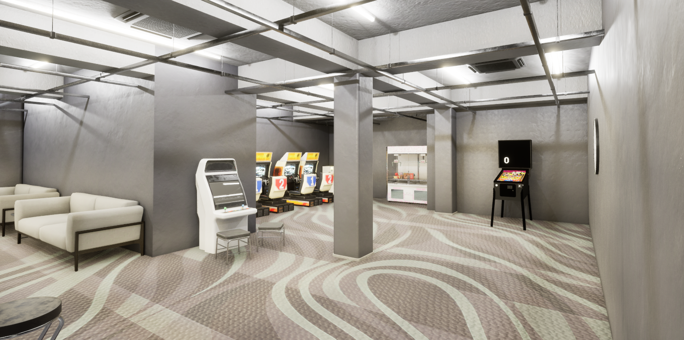

## PROYECTO: PINBALL EN UNREAL ENGINE
Alumno: Guillermo Mata Vizcaíno

## TABLA DE CONTROLES
* **Flipper Derecho:** Flecha derecha (`Right`)
* **Flipper Izquierdo:** Flecha izquierda (`Left`)
* **Lanzador:** Flecha hacia arriba (`Up`)
* **Reinicio:** Letra `Ñ` del teclado

## VALORES FÍSICOS DE LA BOLA Y MATERIAL
* **Friction:** `0.5`
* **Static Friction:** `0.7`
* **Restitution:** `0.5`
* **Density:** `1.0 g/cm3`
* **Simulate Physics:** Activado
* **CCD (Continuous Collision Detection):** Activado para evitar que atraviese geometría fina.

## LISTA DE MEJORAS Y GAME FEEL IMPLEMENTADAS
* Incorporación de efectos de sonido y luces dinámicas al accionar el lanzador
* Modelado y disposición de mobiliario ambiental y elementos decorativos para recrear una sala arcade

 

